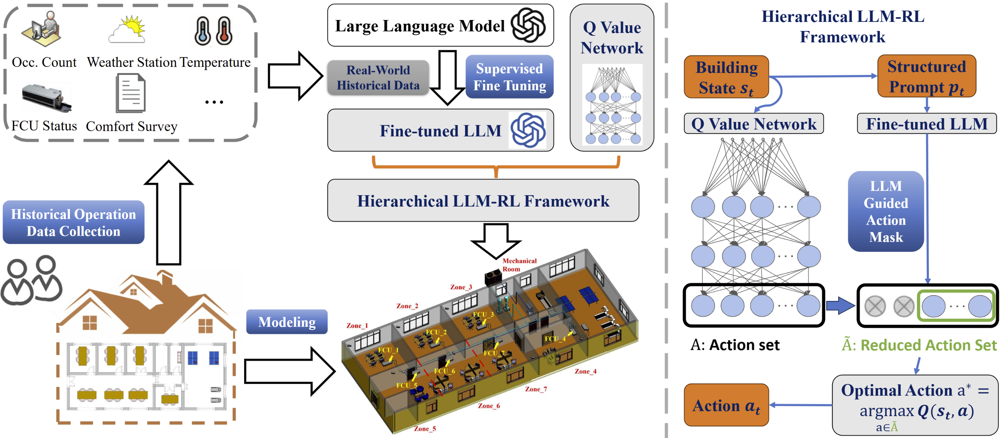

# RL-SPBS

## Introduction

The code implementation for the paper: Hierarchical Control Framework Integrating Large Language Models with Reinforcement Learning for Decarbonized HVAC Operation.





LLM-guided action-mask DQN for multi-room fan coil unit (FCU) control. The 4^7 joint fan-speed actions
(7 rooms x 4 speeds) are pruned by an action mask, which comes from a nearest-neighbour cache of expert
masks and falls back to an LLM when no close state is cached. The cache is updated with the LLM answers.

This repository only releases the algorithm code. The simulation environment `SemiPhysBuildingSim`
and the experiment data are not included; `gym.make("SemiPhysBuildingSim-v0")` must be provided separately.

Built on [RL Baselines3 Zoo](https://github.com/DLR-RM/rl-baselines3-zoo) and
[Stable-Baselines3](https://github.com/DLR-RM/stable-baselines3) (MIT, see `LICENSE`).

## Structure

| Path | Content |
| --- | --- |
| `mask_DQN/` | `MaskDQN` (proposed), `OriginalDQN`, masked policy and replay buffer |
| `rl_zoo3/` | Training framework, `ActionMasker` wrapper and the action feasibility memory (KNN cache + LLM) |
| `action_utils/` | Joint-action encoding and mask construction |
| `interpret_obs.py` | Converts an observation into the text prompt for the LLM |
| `llm_baseline_prompt/` | Prompts and an OpenAI-compatible LLM client |
| `hyperparams/` | `dqn_mask.yml`, `dqn.yml`, `dqn_original.yml`, `bdq.yml` |
| `launch_train.py` | Starts training runs for several seeds |

## Usage

```bash
pip install -r requirements.txt
cp llm_baseline_prompt/config/config.ini.example llm_baseline_prompt/config/config.ini
python launch_train.py
```

Edit `config.ini` to point to your LLM endpoint. The expert mask memory (`.npz` with `obs` and `valid_mask`)
is loaded from the path set in `rl_zoo3/action_mask_info_wrapper.py`; the cache hyper-parameters
(`tau`, `max_size`, ...) are set there as well.

## License

MIT
